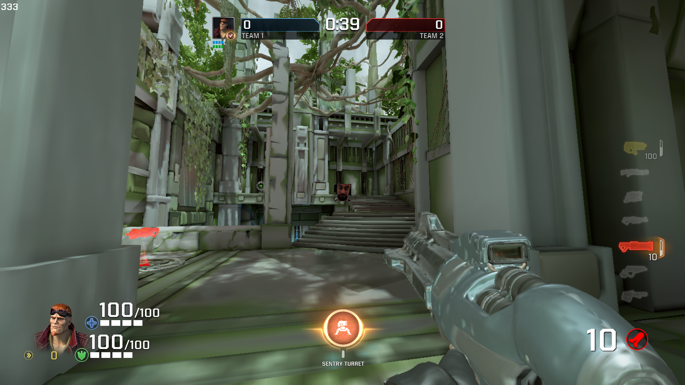
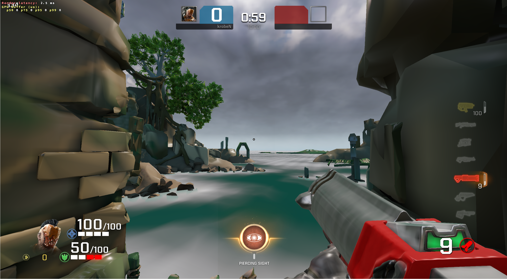

# krosshair
A crosshair overlay for games on linux using vulkan.

## Installation
`make && make install`

On nixos-unstable: Add `krosshair` (or clone and add `(callPackage <local krosshair repo path>/derivation.nix { })`) to packages and `nixos-rebuild switch`.

## Usage
Simply start the your game with `KROSSHAIR=1` set. When using steam, put `KROSSHAIR=1 %command%` into the launch options of your game. Additionally you can use the following variables to customize your crosshair.
- `KROSSHAIR_IMG=/path/to/crosshair-image.png` (i've provided some crosshairs in [here](https://github.com/krob64/krosshair/tree/main/crosshairs), copy them wherever you like)
    - alternatively you can use a [crosshair generator site](https://crosshair.themeta.gg/) (or [this one](https://guywiddacaptain.github.io/aimX/))
- `KROSSHAIR_SCALE=1.0` (scaling the scrosshair may make it look blurry, i'd suggest to just create a bigger/smaller crosshair)

## Can i get banned for this?
I don't know, use at your own risk. I've only used it in Quake Champions and STRAFTAT, both of which don't really have an anticheat.

## Setting up requirements
Needs Vulkan libs to build.
All requirements can be set up with `nix-shell' when nix is installed.
